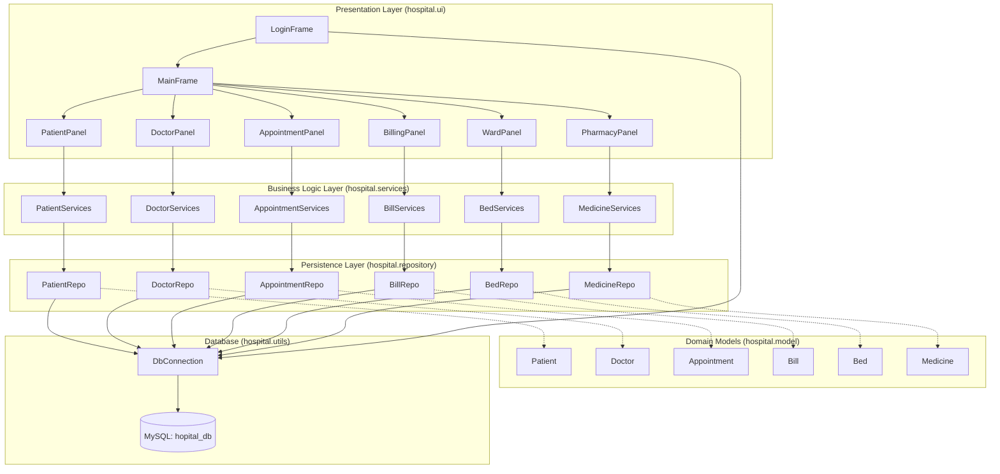

# MediCare - Hospital Management System

> A desktop hospital operations and scheduling management system built with Java Swing and MySQL.


---

## Features

- **Role-Based Authentication**: Secure authentication supporting **Admin**, **Receptionist**, and **Doctor** roles with database credential validation against `users` table and offline fallback.
- **Patient Records Management**: Complete patient onboarding with sequential ID generation (`P-101`), demographic details, blood group, contact information, diagnosis records, and real-time search filtering.
- **Doctor Directory & Scheduling**: Medical specialist directory tracking department specializations, consultation fees, chamber room numbers, qualifications, and visiting hours with specialty filters.
- **Appointment Scheduling**: Consultation booking linking patients and doctors with time-slot allocations, department routing, notes, and visual status badges (`Scheduled`, `Completed`, `Cancelled`).
- **Billing & Invoicing Panel**: Comprehensive hospital invoice creation with auto-calculated totals across consultations, medical treatments, and prescriptions. Supports multiple payment methods (`Cash`, `Card`, `Insurance`, `Bank Transfer`), status badges (`Paid`, `Pending`, `Partial`), and a formatted pop-up receipt preview.
- **Ward & Bed Management**: Inpatient occupancy tracking across hospital wards (`ICU`, `General Ward`, `Emergency`, `Maternity`, `Pediatric`). Includes status indicators (`Occupied`, `Available`, `Under Maintenance`), admission date tracking, and an automated discharge calculator computing length of stay and total hospital room fees.
- **Pharmacy & Medicine Inventory**: Pharmaceutical catalog tracking stock quantities, unit pricing, expiry dates, categories, and manufacturers. Provides automatic real-time low-stock alerts (`<15` units), quick one-click dispensing (`-1`), and batch inventory restock adjustments.
- **Interactive UI with Click-to-Edit**: Responsive Swing desktop UI featuring sidebar navigation, formatted data tables, and click-to-edit row synchronization.
- **Automated Schema Provisioning**: Built-in table initialization in `DbConnection` automatically detects, provisions, and seeds required MySQL schema for all 7 tables on first run.

---

## Tech Stack

| Layer | Technology | Version |
| :--- | :--- | :--- |
| **Language & Runtime** | Java (JDK / JRE) | 17+ (Tested on JDK 27) |
| **Presentation / UI** | Java Swing & AWT | Standard Library (Java SE) |
| **Database** | MySQL | 5.7+ / 8.0+ |
| **JDBC Driver** | MySQL Connector/J | 26.7.0 (`lib/mysql-connector-j-26.7.0.jar`) |
| **Tooling & IDE** | VS Code Java Extension Pack, Windows Batch | Standard |

---

## Architecture

The project follows a layered architecture separating presentation, business logic, persistence, and data models:



---

## Project Structure

```
Hospital Management System/
├── .vscode/
│   └── settings.json           # VS Code source and library classpath configuration
├── lib/
│   └── mysql-connector-j-26.7.0.jar  # MySQL JDBC driver dependency
├── src/
│   └── hospital/
│       ├── App.java            # Application bootstrap and startup routine
│       ├── model/              # Domain entities
│       │   ├── Appointment.java
│       │   ├── Bed.java
│       │   ├── Bill.java
│       │   ├── Doctor.java
│       │   ├── Medicine.java
│       │   └── Patient.java
│       ├── repository/         # Data access objects (PreparedStatements & SQL)
│       │   ├── AppointmentRepo.java
│       │   ├── BedRepo.java
│       │   ├── BillRepo.java
│       │   ├── DoctorRepo.java
│       │   ├── MedicineRepo.java
│       │   └── PatientRepo.java
│       ├── services/           # Service layer coordinating business operations
│       │   ├── AppointmentServices.java
│       │   ├── BedServices.java
│       │   ├── BillServices.java
│       │   ├── DoctorServices.java
│       │   ├── MedicineServices.java
│       │   └── PatientServices.java
│       ├── ui/                 # Swing GUI views and custom component cards
│       │   ├── AppointmentPanel.java
│       │   ├── BillingPanel.java
│       │   ├── DoctorPanel.java
│       │   ├── LoginFrame.java
│       │   ├── MainFrame.java
│       │   ├── PatientPanel.java
│       │   ├── PharmacyPanel.java
│       │   └── WardPanel.java
│       └── utils/
│           └── DbConnection.java # JDBC connection provider & table bootstrap
├── .gitignore                  # Git exclusion rules (build artifacts & binaries)
├── README.md                   # Project documentation
├── run.bat                     # Windows compilation and execution script
└── schema.sql                  # Database definition and initial seed records
```

---

## Getting Started

### Prerequisites

- **Java Development Kit**: JDK 17 or higher installed with `javac` and `java` available on PATH.
- **MySQL Server**: MySQL 5.7+ or 8.0+ (via XAMPP, WampServer, or standalone MySQL Server) running on port `3306`.

### Installation

1. Clone or download the repository into your local workspace:
   ```cmd
   git clone https://github.com/<your-username>/<your-repo>.git
   cd "Hospital Management System"
   ```

2. Verify that the MySQL JDBC jar exists in the `lib/` directory:
   ```cmd
   dir lib\mysql-connector-j-26.7.0.jar
   ```

### Configuration

Database connection settings are configured in [`src/hospital/utils/DbConnection.java`](src/hospital/utils/DbConnection.java):

| Setting | Purpose | Default / Example |
| :--- | :--- | :--- |
| `HOST` | MySQL Server host | `localhost` |
| `PORT` | MySQL Server port | `3306` |
| `DB_NAME` | Target database name | `hopital_db` |
| `USER` | MySQL user account | `root` |
| `PASSWORD` | MySQL password | `1234` |

#### Database Schema Setup
Ensure your MySQL server is running. Create the database via phpMyAdmin or MySQL CLI:
```sql
CREATE DATABASE IF NOT EXISTS hopital_db;
```
You can import [`schema.sql`](schema.sql) directly, or launch the application—`DbConnection.initializeTables()` will automatically create and seed all tables (`users`, `patients`, `doctors`, `appointments`) on startup.

### Running the Application

#### Option 1: Quick Run (Windows)
Execute the provided batch script from the project root:
```cmd
run.bat
```

#### Option 2: Run via VS Code
1. Open the project folder in **Visual Studio Code**.
2. Navigate to [`src/hospital/App.java`](src/hospital/App.java).
3. Press `F5` or click **Run Java** in the top-right corner.

#### Option 3: Manual Command Line
Compile and run manually from the project root:
```cmd
javac -cp "lib/*" -sourcepath src -d bin src\hospital\*.java src\hospital\model\*.java src\hospital\repository\*.java src\hospital\services\*.java src\hospital\ui\*.java src\hospital\utils\*.java
java -cp "bin;lib/*" hospital.App
```

---

## Usage

### Default Login Accounts

The database comes pre-seeded with three default accounts for testing:

| Role | Username | Password | Access Scope |
| :--- | :--- | :--- | :--- |
| **Admin** | `admin` | `admin123` | Full access across all system modules |
| **Receptionist** | `staff` | `staff123` | Patient check-in and appointment booking |
| **Doctor** | `doctor` | `doc123` | Medical review and clinical schedules |

### Workflows

1. **Login**: Launch the app, choose your assigned role, and input your credentials into `LoginFrame`.
2. **Patient Registration**: Open the **Patients** tab. Fill in patient information and click **Add Patient**. Use the filter input above the table to search existing records by name, phone, or ID.
3. **Doctor Directory**: Open the **Doctors** tab to browse active physicians, filter by specialty, or update consultation fees and chamber rooms.
4. **Appointment Booking**: Open the **Appointments** tab. Select the patient, attending doctor, preferred time slot, and clinical notes, then click **Book Visit**. Click an existing booking to update status or reschedule.
5. **Billing & Invoices**: Open the **Billing & Invoices** tab to generate itemized invoices combining consultation, treatment, and medication fees. Select any invoice to preview or print a formatted patient receipt.
6. **Ward & Bed Management**: Open the **Wards & Beds** tab to monitor bed availability across ICU, Emergency, and general wards. Assign incoming patients to vacant beds, or select an occupied bed to calculate the stay duration and discharge the patient.
7. **Pharmacy & Medicine Stock**: Open the **Pharmacy Stock** tab to view drug inventories, filter by medical category or stock status, replenish supplies with the **Adjust Stock** tool, or dispense prescriptions with quick action buttons.

---

## Contributing & License

- **Contributing**: Pull requests and issue reports are welcome. When making modifications, ensure all Java source files compile without warnings and adhere to the established package hierarchy (`hospital.*`).
- **License**: <!-- TODO: confirm license type (e.g. MIT, Apache 2.0, or Proprietary) --> This project is currently provided for educational and clinical administration evaluation. Add a formal `LICENSE` file in the project root if publishing as open source.
