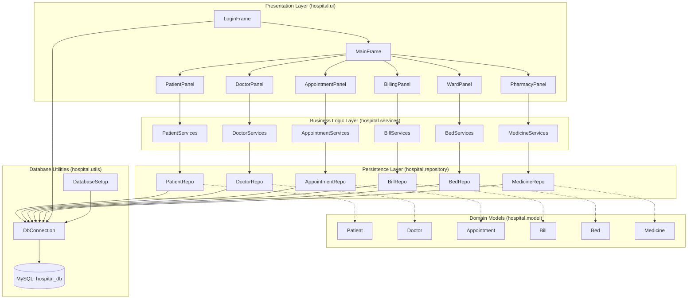

# MediCare - Hospital Management System

> A modular desktop hospital operations and scheduling management system built with Java Swing, JDBC, and MySQL.


---

## Features

- **Role-Based Access Control (RBAC)**: Enforces customized operational workspaces and permissions for **Admin**, **Doctor**, and **Receptionist** roles with authentication backed by the `users` table.
- **Patient Records Management**: Onboard and track patients with sequential ID generation (`P-101`), demographic records, blood group, contact info, clinical diagnosis notes, and real-time search filtering.
- **Doctor Directory & Schedules**: Medical specialist directory tracking department specialties, chamber room numbers, consultation fees, qualifications, and visiting hours with specialty-based filtering.
- **Appointment Scheduling**: Consultation booking linking patients and doctors with time-slot allocations, department routing, clinical visit notes, and status indicators (`Scheduled`, `Completed`, `Cancelled`).
- **Billing & Invoicing**: Comprehensive invoice generator calculating itemized totals across consultation, treatments, and prescribed medicines with support for multiple payment methods (`Cash`, `Card`, `Insurance`) and printable receipt previews.
- **Ward & Bed Occupancy**: Inpatient ward tracker (`ICU`, `General Ward`, `Emergency`, `Maternity`, `Pediatric`) monitoring live bed statuses (`Available`, `Occupied`), patient admissions, and automated discharge fee calculations.
- **Pharmacy & Stock Inventory**: Drug inventory catalog managing unit pricing, stock thresholds, batch expiry dates, and categories. Includes instant one-click dispensing (`-1`) and inventory restock adjustments.
- **Automated Self-Provisioning Database**: `DatabaseSetup` automatically creates `hospital_db` on the local MySQL server on startup, provisions all 7 relational tables, and ensures base role accounts are initialized.
- **Cross-Platform Swing UI**: Custom anti-aliased button painting (`paintComponent`) ensuring consistent, high-contrast button styling across Windows visual styles and standard Look-and-Feels.

---

## Tech Stack

| Layer | Technology | Version |
| :--- | :--- | :--- |
| **Language & Runtime** | Java (JDK / JRE) | 17+ (Tested on JDK 27) |
| **Presentation / UI** | Java Swing & AWT | Standard Library (Java SE) |
| **Database** | MySQL | 5.7+ / 8.0+ |
| **JDBC Driver** | MySQL Connector/J | 26.7.0 (`lib/mysql-connector-j-26.7.0.jar`) |
| **Build & Tooling** | Windows Batch (`run.bat`), VS Code Java Tools | Standard |

---

## Architecture

The project follows a 5-layer enterprise architecture cleanly separating UI views, business service coordinators, data repositories, domain POJOs, and database connection utilities:



---

## Project Structure

```
Hospital Management System/
├── .vscode/
│   └── settings.json           # VS Code source and library classpath configuration
├── lib/
│   └── mysql-connector-j-26.7.0.jar  # MySQL JDBC driver dependency
├── src/
│   └── hospital/
│       ├── App.java            # Application bootstrap and startup routine
│       ├── model/              # Domain POJO entities
│       │   ├── Appointment.java
│       │   ├── Bed.java
│       │   ├── Bill.java
│       │   ├── Doctor.java
│       │   ├── Medicine.java
│       │   └── Patient.java
│       ├── repository/         # Data access objects (PreparedStatements & SQL queries)
│       │   ├── AppointmentRepo.java
│       │   ├── BedRepo.java
│       │   ├── BillRepo.java
│       │   ├── DoctorRepo.java
│       │   ├── MedicineRepo.java
│       │   └── PatientRepo.java
│       ├── services/           # Service coordinators & business logic validation
│       │   ├── AppointmentServices.java
│       │   ├── BedServices.java
│       │   ├── BillServices.java
│       │   ├── DoctorServices.java
│       │   ├── MedicineServices.java
│       │   └── PatientServices.java
│       ├── ui/                 # Swing views, custom cards, and management panels
│       │   ├── AppointmentPanel.java
│       │   ├── BillingPanel.java
│       │   ├── DoctorPanel.java
│       │   ├── LoginFrame.java
│       │   ├── MainFrame.java
│       │   ├── PatientPanel.java
│       │   ├── PharmacyPanel.java
│       │   └── WardPanel.java
│       └── utils/              # Database initialization and JDBC connectivity
│           ├── DatabaseSetup.java
│           └── DbConnection.java
├── .gitignore                  # Git exclusion rules
├── README.md                   # Project documentation
├── run.bat                     # Windows compilation and launch script
└── schema.sql                  # Database DDL schema & base authentication accounts
```

---

## Getting Started

### Prerequisites

- **Java Development Kit**: JDK 17 or higher installed with `javac` and `java` available on your system `PATH`.
- **MySQL Server**: MySQL 5.7+ or 8.0+ (via XAMPP, WampServer, or standalone MySQL service) active on port `3306`.

### Installation

1. Clone or download the repository into your local workspace:
   ```cmd
   git clone https://github.com/<your-username>/<your-repo>.git
   cd "Hospital Management System"
   ```

2. Confirm the presence of the MySQL JDBC driver:
   ```cmd
   dir lib\mysql-connector-j-26.7.0.jar
   ```

### Configuration

Database connection constants are defined in [`src/hospital/utils/DbConnection.java`](src/hospital/utils/DbConnection.java):

| Constant | Description | Default Value |
| :--- | :--- | :--- |
| `BASE_URL` | MySQL server root URL | `jdbc:mysql://localhost:3306/` |
| `DB_NAME` | Application database name | `hospital_db` |
| `USER` | MySQL database username | `root` |
| `PASSWORD` | MySQL database password | `1234` |

> [!NOTE]
> If your local MySQL (e.g., standard XAMPP) uses a blank password, change `PASSWORD` in `DbConnection.java` to `""`.

### Database Initialization

Ensure MySQL is running on port `3306`. You do not need to create tables manually:
- Launching the application automatically executes `DatabaseSetup.initialize()`, which creates the database `hospital_db` (if missing), creates all 7 tables, and initializes default user roles.
- Alternatively, you can import [`schema.sql`](schema.sql) directly via MySQL CLI or phpMyAdmin.

---

## Running the Application

### Option 1: Quick Run via Script (Windows)
Double-click or run [`run.bat`](run.bat) from the project root:
```cmd
run.bat
```

### Option 2: VS Code
1. Open the workspace root folder in **Visual Studio Code**.
2. Open [`src/hospital/App.java`](src/hospital/App.java).
3. Press `F5` or click **Run Java**.

### Option 3: Manual Command Line
From the project root:
```cmd
javac --release 17 -cp "lib/*" -sourcepath src -d bin src\hospital\*.java src\hospital\model\*.java src\hospital\repository\*.java src\hospital\services\*.java src\hospital\ui\*.java src\hospital\utils\*.java
java -cp "bin;lib/*" hospital.App
```

---

## Usage & Access Control

### Default Login Accounts

The system provisions three base accounts for different operational scopes:

| Role | Username | Password | Operational Scope |
| :--- | :--- | :--- | :--- |
| **Admin** | `admin` | `admin123` | **Full Administrative Access**: Unrestricted access across all 6 panels, including doctor hiring, stock adjustments, and record deletion. |
| **Doctor** | `doctor` | `doc123` | **Clinical Review**: Lands directly on the appointment consultation queue. Can update patient diagnoses, monitor ward bed occupancy, and view medicine stock. Financial billing is hidden. |
| **Receptionist** | `staff` | `staff123` | **Front Desk Operations**: Patient onboarding, appointment booking, invoice generation, bed admissions/discharges, and medication dispensing. Destructive deletions are blocked. |

### Role Privilege Matrix

| Module / Action | Admin | Doctor | Receptionist |
| :--- | :---: | :---: | :---: |
| **Patients** (Register & Edit) | Full | Update Diagnosis | Register & Demographics |
| **Patients** (Delete) | Allowed | Blocked | Blocked |
| **Doctor Directory** | Full CRUD | View-only | View-only |
| **Appointments** | Full CRUD | View Queue & Add Notes | Book, Reschedule, Cancel |
| **Billing & Invoices** | Full CRUD | *Hidden from menu* | Create Invoices & Print |
| **Wards & Beds** | Full CRUD | View Occupancy | Allocate & Discharge |
| **Pharmacy Stock** | Full CRUD | View Availability | Dispense (`-1`) |

---

## Contributing & License

- **Contributing**: Contributions and pull requests are welcome. Please ensure all modifications compile cleanly with `javac --release 17 -cp "lib/*"` without warnings.
- **License**: <!-- TODO: confirm license type (e.g., MIT, Apache 2.0, or Proprietary) --> Provided for academic and institutional evaluation.
